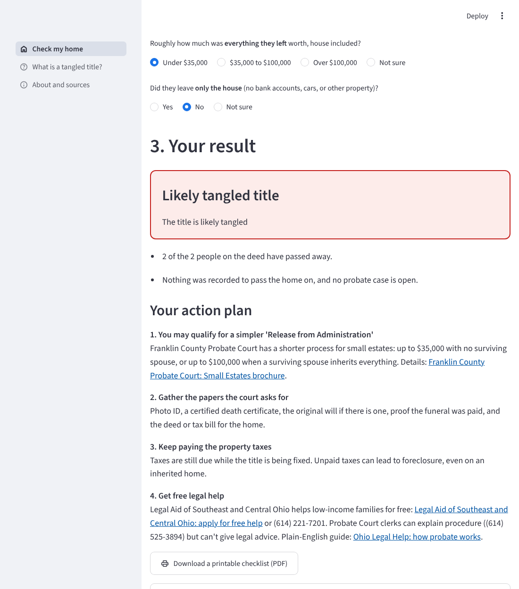

# Home Title Checkup

**Is your family's home legally in the right name?** Home Title Checkup looks up a Franklin County, Ohio home in the
County Auditor's public records, asks a few yes / no questions, and gives the family a plain-English status and a
printable action plan to fix a "tangled title", or to prevent one.



**Live app:** _add your Streamlit Community Cloud link here_
**Demo video:** _add your YouTube link here_

## The problem

When a homeowner dies and nobody files the paperwork, the home stays in the dead person's name. The family keeps
living there, but they can't prove they own it. That's called a tangled title, or heirs' property.

- Ohio has an estimated **9,000** heirs' properties ([Greater Ohio Policy Center, 2024](https://www.greaterohio.org/blog/2024/8/27/heirs-properties-in-ohio)).
- They hold about **$313 million** in family wealth that a clear title could unlock ([LISC, 2024](https://lisc.org/our-stories/story/lisc-brings-heirs-property-relief-to-under-resourced-communities-in-cincinnati-and-cleveland)).
- Without a clear title, families can't get home-repair financing, claim the homestead tax break, get disaster aid,
  or borrow against the home (LISC, 2024).

Ohio already has a simple way to prevent it: a **Transfer on Death Designation Affidavit**
([ORC 5302.22](https://codes.ohio.gov/ohio-revised-code/section-5302.22)), recorded with the County while the owner
is alive. Most families have never heard of it.

## What the app does

1. **Find the home.** Type an address. The app asks the Franklin County Auditor's public parcel records who is on the
   deed and when the home last changed hands.
2. **Answer a few questions.** Is everyone on the deed living? Was a Transfer on Death affidavit recorded? Has
   probate been opened?
3. **Get a result and a plan.** One of five statuses (Looks protected, On the way, Not protected yet, Likely tangled,
   Need more information), the reasons, numbered steps with official Franklin County links, and a printable PDF
   checklist. Every plan ends with free legal help.

There's also a "What is a tangled title?" explainer page and a "Try a demo home" button that uses a made-up home,
so anyone can test the app without looking up a real family.

## Run it on your computer

You need Python 3.12 or 3.13.

**Windows (Command Prompt, in the project folder)**
```
python -m venv .venv
.venv\Scripts\activate
pip install -r requirements.txt
streamlit run app.py
```

**Mac (Terminal, in the project folder)**
```
python3 -m venv .venv
source .venv/bin/activate
pip install -r requirements.txt
streamlit run app.py
```

The app opens at http://localhost:8501.

## Put it online (free)

1. Push this repository to GitHub.
2. Go to [share.streamlit.io](https://share.streamlit.io), sign in with GitHub, and click **Create app**.
3. Pick this repository, branch `main`, main file `app.py`. Under **Advanced settings**, choose Python 3.13.
4. Click **Deploy**. Paste the link at the top of this README.

## Run the tests

```
pip install -r requirements-dev.txt
pytest
```

The tests cover the address cleanup, the County lookup (using a saved sample response, so no internet is needed),
every decision path, and the PDF.

## How it works

| File | What it does |
|---|---|
| `app.py` | Page setup, styles, navigation |
| `app_pages/check.py` | The 3-step checkup screen |
| `app_pages/learn.py` | "What is a tangled title?" explainer |
| `app_pages/about.py` | Purpose, privacy, limits, sources |
| `titlecheck/lookup.py` | Cleans up the typed address and queries the County's parcel records |
| `titlecheck/assess.py` | The decision rules: answers to status and action plan |
| `titlecheck/checklist.py` | Builds the printable PDF |
| `titlecheck/resources.py` | Official links, phone numbers and facts in one place |
| `tests/` | Automated tests |

**Data source.** Franklin County Auditor, ArcGIS REST service `ParcelFeatures/Parcel_Features/MapServer/0`
(Tax Parcel layer). Fields used: `PARCELID`, `SITEADDRESS`, `ZIPCD`, `OWNERNME1` to `OWNERNME3`, `SALEDATE`,
`CLASSDSCRP`. The app sends one query per address and only letters, numbers and spaces reach the query.

**Decision rules** (`titlecheck/assess.py`), based on Ohio law and Franklin County Probate Court's published options:
- Everyone on the deed living, Transfer on Death affidavit recorded: **Looks protected**
- Everyone living, nothing recorded: **Not protected yet**, with the Transfer on Death steps
- Someone died, survivorship deed / Transfer on Death affidavit / open probate: **On the way**, with the filing that finishes it
- Someone died, nothing filed: **Likely tangled**, with the simplest court route for the estate's size
  (Release from Administration: up to $35,000, or up to $100,000 when a surviving spouse inherits everything;
  Real Estate Transfer Only; or full probate)
- Not sure about a key fact: **Need more information**, with how to find out
- Trusts, estates and organizations are recognized from how the County writes the owner name.

## Privacy and safety by design

- One address at a time. The app never builds lists or maps of homes that might have tangled titles, because people
  who prey on heirs' property could misuse them.
- Nothing typed is saved. Owner names shown are already public on the County Auditor's website.
- General information, not legal advice, and every plan points to free legal help.

## Limits

- Franklin County only.
- County records can lag behind recent filings, and the app can't see whether a Transfer on Death affidavit was
  recorded; it asks, and shows how to check at the Recorder.
- Fees, forms and phone numbers change. Check `titlecheck/resources.py` against the official sites before each release.

## Ideas for version 2.0

- More Ohio counties (most publish the same kind of parcel data).
- Spanish and Somali translations, reviewed by native speakers.
- Search the Recorder's records automatically for an existing Transfer on Death affidavit.
- Work with Legal Aid or a community group so the action plan can be sent straight to an advocate.

## Sources

- [Greater Ohio Policy Center: Heirs' Properties in Ohio (2024)](https://www.greaterohio.org/blog/2024/8/27/heirs-properties-in-ohio)
- [LISC: heirs' property relief in Cincinnati and Cleveland (2024)](https://lisc.org/our-stories/story/lisc-brings-heirs-property-relief-to-under-resourced-communities-in-cincinnati-and-cleveland)
- [Ohio Revised Code 5302.22: Transfer on Death Designation Affidavit](https://codes.ohio.gov/ohio-revised-code/section-5302.22)
- [Ohio Revised Code 5302.222: confirmation affidavit](https://codes.ohio.gov/ohio-revised-code/section-5302.222)
- [Franklin County Law Library: Transfer on Death forms](https://fclawlib.libguides.com/TOD/transferondeathaffidavit)
- [Franklin County Probate Court: Small Estates brochure](https://Probate.franklincountyohio.gov/PBCT-website/media/Documents/Pamphlets/Small-Estates.pdf)
- [Ohio Legal Help: overview of probate](https://www.ohiolegalhelp.org/topic/overview-probate-administration-ohio)
- [Franklin County Recorder: Real Estate](https://www.franklincountyohio.gov/Agency-Directory/Recorder/Real-Estate)
- [Legal Aid of Southeast and Central Ohio](https://lasco.org/)

## Team

_Your names, school(s), grade(s)_

## Use of AI tools

The first version of this code (the app, decision rules, tests and this README) was generated by Claude, an AI
assistant from Anthropic, from our project plan, and checked against official Ohio and Franklin County sources.
_Describe here what you changed, built and tested yourselves, and how you checked the results._
